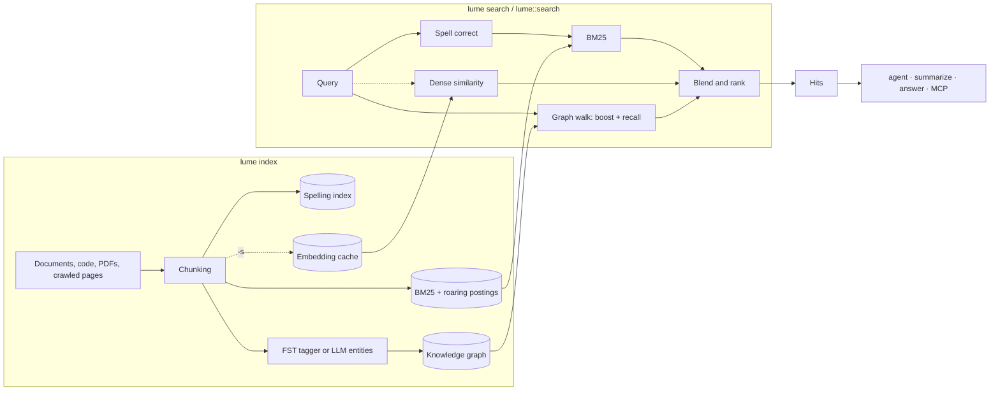

<div align="center">

# Lume

**One store for the numbers and the words.**

[](https://github.com/DeepBlueDynamics/lume/actions/workflows/ci.yml)
[](LICENSE)
[](https://www.rust-lang.org/)
[](#mcp-server)

[Quick start](#quick-start) · [Lume TI](#lume-ti-telemetry-index) · [Performance](#performance)

</div>


---

Your measurements live in a database. Your explanations live in documents. Your incident history lives in logs. The questions that matter cross all three:

*What was the system doing when this error appeared, and what did we learn the last time it happened?*

Lume brings documents and time-series telemetry into one queryable system, running on hardware you control. Search the words, filter the measurements, and join events to what happened during them. One Rust binary, with SQL for analysis and MCP tools for agents.

The retrieval engine combines keyword search, optional semantic search, and an entity-relationship graph. Search, dictionary-based graph construction, and telemetry SQL work without a language model. Add a model for conversational answers and agent workflows, not because the database needs one to find your data.

For people building and operating agents, Lume also receives OpenTelemetry metrics and logs, makes those events searchable, and exposes a read-only PostgreSQL interface for tools such as Grafana. The same system can hold the operational numbers and the written evidence needed to investigate them.

### Built for places where the cloud is optional

Marine systems are a strong application, not a separate promise. Lume already reads live Signal K telemetry and historical Signal K Parquet files, connects measurements with logbook entries and alerts, and runs on a Raspberry Pi alongside the existing onboard software. Its Signal K plugin provides a SQL console, document library, and an Ask interface.

On a boat, the question becomes: *What was the engine doing each time this alarm appeared?* The same underlying problem exists ashore: the measurements and the written history need to be queried together.

**Built for the boat. Useful well beyond it.**

An open source project from [DeepBlue Dynamics](https://github.com/deepbluedynamics/),
which builds open source agentic tooling for the marine electronics market.
DeepBlue's promise: agents and people can ask questions of a boat's instruments,
logs and documents, on board and without a connection.

The default build has **four runtime dependencies** (`tantivy-fst`, `ureq`, `serde`, `serde_json`). The time-series engine (DataFusion, Arrow, Parquet) sits behind `--features ti`.

## Highlights

- **Documents and time series in one SQL query (Lume TI):** 10-second and 1-second buckets stored as roaring bitmaps; filters, aggregates, geography (`within_nm`), "held for N minutes" (`intervals()`) and full-text `match()` push down into bitmap operations. Queried from SQL, a REPL, MCP tools, HTTP or pgwire. [See below.](#lume-ti-telemetry-index)
- **Hybrid retrieval:** BM25 (classic, plus and L variants), dense vectors and a graph boost, blended per query with one `--alpha` knob.
- **Index-native knowledge graph:** entity co-occurrence is computed from roaring-bitmap intersections ("counting the counts"). Edges are scored by statistical significance, so hub entities don't drown out real associations.
- **Deterministic or LLM entities:** build the graph from a local FST dictionary with no model at all, or extract entities with Ollama. The graph math is identical either way.
- **Agentic tools:** a planning and retrieval agent with structured failure recovery, a graph-guided document summarizer, and cited answers.
- **MCP server:** exposes indexing, search, and time-series query tools to any MCP-capable agent over HTTP.
- **OTLP telemetry receiver:** ingests OpenTelemetry metrics and logs directly from coding agents (Claude Code, Codex, Gemini) into dedicated `telemetry_agents` and `docs` tables.
- **Postgres wire & Grafana:** native read-only pgwire protocol (`--pg`) with SCRAM-SHA-256 for psql and Grafana, with prebuilt dashboards for agent telemetry.
- **Measured quality:** `lume eval` reports Hit@k, MRR and nDCG@k against Q&A files, without hand labels.

## Quick start

Install the binary. Prebuilt releases cover Linux x64/arm64, macOS (Intel and Apple Silicon) and Windows x64.

```bash
# Linux / macOS (installs to ~/.local/bin)
curl -fsSL https://github.com/DeepBlueDynamics/lume/releases/latest/download/install.sh | sh
```

```powershell
# Windows (installs to %LOCALAPPDATA%\Programs\lume and adds it to PATH)
irm https://github.com/DeepBlueDynamics/lume/releases/latest/download/install.ps1 | iex
```

Grab a book, index it and search it:

```bash
mkdir books && cd books
curl -fsSLO https://raw.githubusercontent.com/DeepBlueDynamics/lume/main/docs/monte_cristo/book.md
cd ..

lume index books
lume search "Edmond Dantès prison escape"
```

Or ask it questions in SQL:

```bash
lume sql repl --db .lume-index
```
```sql
sql> SELECT title, score FROM sections WHERE match(body, 'dantes escape') ORDER BY score DESC LIMIT 3;
```

That's it. Point `lume index` at any folder of text, Markdown, code or PDFs. The index goes to `.lume-index/`; use `--db <dir>` to keep several side by side.

## Ollama setup

Ollama is optional. Lume uses it for LLM entity extraction (`lume index -o`), `lume agent` / `lume chat`, summaries, and the Signal K plugin's **Ask** tab. Search, the graph and Lume TI SQL all work without it. There are two ways to run it.

### Local Ollama (laptop or desktop)

1. Install Ollama from [ollama.com/download](https://ollama.com/download) and start it. It listens on `http://localhost:11434`, which is Lume's default.
2. Pull a model, for example `ollama pull qwen3:8b`.
3. Point Lume at it:

```bash
lume index docs/ -o --ollama-model qwen3:8b
lume chat --ti-store <store> --ollama-model qwen3:8b "What was the lowest battery voltage today?"
```

`--ollama-url` sets a different endpoint. Some commands also read `$OLLAMA_URL`.

### Cloud models via ollama.com (no local GPU)

Models with a `:cloud` tag, such as `glm-5.3:cloud`, run on Ollama's servers. Create an API key at [ollama.com](https://ollama.com/) and export it:

```bash
export OLLAMA_API_KEY=...        # read from the environment; never pass it as a flag
lume chat --ti-store <store> --ollama-url https://ollama.com --ollama-model glm-5.3:cloud "Summarise today's engine hours"
```

Lume sends `OLLAMA_API_KEY` **only** to `ollama.com` hosts. A local or LAN Ollama never receives it.

### Several endpoints with failover

`--ollama-url` takes a comma-separated list. Lume tries each in order and uses the first reachable one that has the model:

```bash
lume chat --ollama-url https://ollama.com,http://192.168.1.20:11434 --ollama-model glm-5.3:cloud ...
```

To share a laptop's Ollama with the boat's LAN, set `OLLAMA_HOST=0.0.0.0` on the laptop, restart Ollama, and allow TCP 11434 for the private network only. Ollama itself has no authentication.

### Ask tab on a Raspberry Pi (Signal K plugin)

The Ask tab defaults to `https://ollama.com` with `glm-5.3:cloud`, so the Pi doesn't need a local model. On the Pi 5, a local `qwen3:1.7b` produced 0.34 tokens/s. To install your key, run this from the repo on your machine:

```bash
scripts/pi-set-ollama-key.sh <ssh-host>      # e.g. pi@halos.local
```

It prompts for the key with hidden input and sends it to the Pi only over SSH stdin, so it never appears in argv, shell history or logs. On the Pi it:
- writes `ollama.key` (owner 1000:1000, mode 600);
- sets **Chat API Key File Path** in the plugin config;
- restarts Signal K.

`--check` shows the file's owner, mode and size, never its contents. To use a laptop's local models as a fallback, set **Chat Ollama API URLs** in the plugin config to, for example, `https://ollama.com,http://192.168.68.58:11434`.

## Features

### Hybrid search

`lume search` runs BM25 over the persisted index. When the index was built with `-s` and an embedding endpoint is reachable, it blends dense semantic similarity in as well. Spelling correction (`-c`) repairs misspelled query terms against the index vocabulary.

Lexical retrieval uses English stemming (Snowball) and field-aware BM25 without coordination penalty by default (`LUME_STEM=0` opts out at index time, `LUME_COORD_FLOOR` overrides coordination floor, default `1.0`). If searching an index built before default stemming, Lume prints a notice suggesting `lume index -f` to reindex. Term exclusion via `-term` and `NOT term` is supported (e.g. `cancer -therapy`), subtracting excluded posting lists from candidates via `MiniRoaring::andnot`.

```bash
lume search "Edmond Dantes"                 # lexical BM25
lume search "cancer -therapy"               # term exclusion with -term
lume search "vitamin d NOT deficiency"      # boolean NOT exclusion
lume search -c -a 0.5 "Edmund Dantez"       # hybrid with spell correction
lume search -a 0 -g 0 "run_agent_loop"      # pure lexical, no graph boost
```

### Semantic Knowledge Graph

During indexing, Lume tags entities in every section and builds a co-occurrence graph from pairwise roaring-bitmap intersections. At query time it resolves the entities in the query, walks one hop to their strongest neighbours, and:

- **boosts** passages that mention related entities (`-g`, default `0.4`);
- **recalls** strongly related passages that have no lexical hit at all.

Edges carry both Jaccard overlap and a **significance score**: a z-score of observed vs. expected co-occurrence (`|A||B|/N`), squashed to `[-1, 1]`. Choose with `--scoring relatedness` (default) or `--scoring jaccard`.

Entities come from either:
- a **local FST dictionary** (`--tag-dict dict.csv`), which is deterministic, offline and fast; or
- **LLM extraction** with Ollama (`-o`), using parallel workers set by `LUME_EXTRACT_WORKERS`.

### Semantic search

Dense embeddings come from a Shivvr endpoint (GTR-T5 space), set with `--shivvr-url` or `SHIVVR_BASE_URL` (default `http://localhost:8085`). Embeddings are cached per index, and search degrades gracefully to lexical when the endpoint is unavailable.

### Agents, summaries and answers

```bash
lume agent "Explain the relationship between Villefort and Mercedes"
lume summarize docs/my_documents/book.pdf
lume answer "Who betrayed Dantès, and why?"
```

- **`agent`** runs a tool-calling loop (search, index, generate) until it can answer. When its searches miss, a dedicated `lume_not_found` tool steers it to refine its queries instead of guessing.
- **`summarize`** takes the top 12 entities from the knowledge graph as priors, plans targeted searches, de-duplicates the passages and writes an executive summary.
- **`answer`** runs plan → retrieve → evaluate → refine, and returns a **cited** answer. It streams events for the visualizer.

### MCP server

```bash
lume serve --bind 127.0.0.1 # local, default port 5863 ("LUME" on a phone keypad)
lume serve --bind 127.0.0.1 --port 8080
```

This exposes `lume_index`, `lume_search`, `lume_generate` and `lume_not_found` as MCP tools over HTTP. Search runs in-process through the `lume::search` library API. Built with `--features ti`, `lume serve --ti-store <store>` adds the [Lume TI](#lume-ti-telemetry-index) tools, OTLP ingestion (`--otlp`), and PostgreSQL wire access (`--pg`).

All serve paths default to `127.0.0.1`, including plain `lume serve`. An explicit non-loopback bind requires `--nuts-auth` or `--http-token-file`.

Use `--nuts-auth --nuts-allow sailor@example.com,user-17` on plain/TI `serve` or `ti ingest --serve`. The optional auth URL defaults to `https://auth.nuts.services`; an allowlist may also be supplied as `--nuts-allow @/path/to/allowlist`. Send a nuts RS256 JWT or an `ahp_` token in `Authorization: Bearer <token>`. JWTs verify offline using startup/12-hour JWKS refresh and a public-key cache at `<store>/auth/jwks.json` (plain serve: `.lume-index/auth/jwks.json`); AHP tokens exchange online and cache their verified JWT in memory until expiry. Allowlist membership is mandatory. Read scope covers TI/MCP/SSE; write covers OTLP and indexing (MCP indexing needs both). GET `/health` is public when nuts auth is on. No key cache plus no network refuses startup.

`--http-token-file /path/to/token` remains a full-access static alternative, checked in constant time. It may coexist with nuts auth. Configured sync/OTLP tokens override global auth on their own routes. Missing, wrong or unauthorized credentials return empty-body 401. Never put credentials in a URL; use HTTPS through a trusted reverse proxy for remote access. Loopback without either flag retains local access.

The OTLP bearer protects ingestion routes only on a shared server; it does not authenticate TI or MCP. Standalone `lume ti otlp` exposes only its two ingestion endpoints.

### Plain index SQL (`lume sql`)

`lume sql` runs DataFusion queries directly over any ordinary Lume index (built with `--features ti`). It exposes three tables:
- `sections`: `(id, file, title, line, body, score)`
- `entities`: `(entity, doc_count)`
- `entity_edges`: `(a, b, jaccard, relatedness)`

Full-text `match(body, 'query')` filters push down to lexical BM25 retrieval:
- **Positive match**: `WHERE match(body, 'query')` (populates `score` with BM25 score).
- **Conjunction**: `WHERE match(body, 'a') AND match(body, 'b')` (intersects candidate sections).
- **Negation**: `WHERE match(body, 'a') AND NOT match(body, 'b')` or standalone `WHERE NOT match(body, 'x')` (excludes matching sections; without a positive match, `score` is `NULL`). Excluding rows does not rescore surviving rows.
- Note: `match()` must be a top-level `AND` filter; disjunctions (`match(...) OR ...`) cannot be pushed down and error cleanly.

```bash
lume sql --db .lume-index "SELECT id, title, score FROM sections WHERE match(body, 'dantes') ORDER BY score DESC LIMIT 5"
lume sql --db .lume-index "SELECT id, title, score FROM sections WHERE match(body, 'dantes') AND NOT match(body, 'prison')"
lume sql --db .lume-index "SELECT count(*) FROM sections WHERE NOT match(body, 'prison')"
```

### Text generation

`lume generate` synthesizes text in the corpus's style with a trigram Markov chain. It steers the chain toward concept tags (`--steer "revenge,castle"`) or, with an embedding endpoint, toward a target vector, using GTR-T5 inversion to hill-climb candidates.

### Crawling

`lume crawl <url>` saves a page as Markdown for indexing. It uses a local Grub crawler when `GRUB_BASE_URL` points at one; it authenticates to a remote one with `NUTS_SERVICES_TOKEN`; otherwise it falls back to a plain HTTP GET. Hacker News story URLs are assembled from the public API, story plus top-level comments.

### Retrieval evaluation

```bash
lume index --db .lume-eval-index --tag-dict dict/characters.csv docs/monte_cristo
lume eval  --db .lume-eval-index --compare docs/monte_cristo/qna.json
```

This reports **Hit@k, MRR and nDCG@k**. A section counts as relevant when it contains at least `--threshold` of the answer's content tokens, so no human labels or chunk alignment are needed. `--compare` runs both graph scoring modes and prints the difference. On *The Count of Monte Cristo* (1,926 sections, 373 questions), lexical BM25 reaches **Hit@10 ≈ 90 %** on single-fact questions.

### Visualizer

`lume stream <query>` emits the search's relaxation dynamics as NDJSON, and [`viz/`](viz/README.md) renders it as a live 3D field. `lume answer` streams into the same view, highlighting the passages the model was given and the ones it cited.

## Architecture



## Build from source

Needs Rust stable. `cargo build --release` puts the binary at `target/release/lume`; add `--features ti` for the telemetry engine and `lume sql`. Optional: [Ollama](https://ollama.com/) for entity extraction, agents and summaries; a [Shivvr](#semantic-search) endpoint for dense embeddings; Python 3.10+ with `requests` and `pypdf` for PDF extraction.

Maintainers cut a release from **Actions → Bump version and release**.

## Using Lume: documents

**Index a folder.** Text, Markdown, code, PDFs and EPUBs all work. Re-running the command picks up added, changed and deleted files.

```bash
lume index ~/manuals                      # writes .lume-index/
lume index ~/manuals --db ~/indexes/boat  # keep several indexes side by side
lume index ~/manuals -o                   # also extract entities with Ollama
LUME_INDEX_FORMAT=4 lume index ~/manuals  # binary index: smaller and faster to open
```

**Search it.** Results blend keyword scoring, optional vectors and the entity graph. Misspellings are corrected, and `-term` excludes a word.

```bash
lume search "bilge pump wiring"
lume search "bilge pump -manual" -l 20   # NOT, more results
lume search "pump" --facet category      # counts by a frontmatter field
lume search "fuel filter" -a 0.7 -g 0.4  # vector weight, graph weight
```

**Query it with SQL.** The tables are `sections`, `entities` and `entity_edges`, and `match()` gives each row a BM25 `score`.

```bash
lume sql --db .lume-index "SELECT title, score FROM sections WHERE match(body, 'impeller') ORDER BY score DESC LIMIT 5"
lume sql repl --db .lume-index
```

**Give it to agents.** `lume serve` starts an MCP server on `127.0.0.1:5863` with search, index and SQL tools.

**Ask questions** (needs [Ollama](#ollama-setup)):

```bash
lume answer "How do I winterize the watermaker?"     # cited answer
lume agent "What maintenance is overdue?"            # multi-step research
lume summarize ~/manuals/engine.pdf
```

**Add web pages.** `lume crawl <url>` saves a page as Markdown, ready to index. When a [Grubcrawler](deploy/halos/marine-grubcrawler-container/README.md) is running on `localhost:6792`, Lume uses it to render JavaScript pages. Otherwise it fetches the page directly.

```bash
docker run -d -p 127.0.0.1:6792:6792 -e DISABLE_AUTH=true deepbluedynamics/grubcrawler:latest-lite
```

**Measure it.** `lume eval qna.json` reports Hit@k, MRR and nDCG@k against a question-and-answer file.

| Command | What it does |
|---|---|
| `lume index <dir>` | Build or update an index (`--db`, `-o` entities, `-f` full rebuild) |
| `lume index gc` | Remove old copies of a binary index (`--dry-run`) |
| `lume search <query>` | Search (`-l` limit, `-a` alpha, `-g` graph, `-c` spell check, `--facet`) |
| `lume sql [repl]` | SQL over an index |
| `lume serve` | MCP server for agents, plus the TI HTTP, OTLP and pgwire services |
| `lume answer` / `lume agent` / `lume summarize` | Answers, research and summaries with Ollama |
| `lume crawl <url>` | Save a web page as Markdown |
| `lume eval <qna.json>` | Retrieval quality metrics |
| `lume generate <seed>` / `lume stream <query>` | Text generation; NDJSON search dynamics for `viz/` |

Run `lume <command> --help` for every option.

## Lume TI: Telemetry Index

Lume TI keeps **documents and time series in one store** and lets one SQL query reach across both. A boat's sensor data, its logbook, notes and alerts, and its position all live in the same column space, so *"what was the boat doing during every alarm this month?"* or *"when did we see shallow water at anchor within a minute of a leak note?"* are single queries.

It reads **[Signal K](https://signalk.org/) out of the box**, live from the server's WebSocket stream and historically from `signalk-parquet` files, and it runs on the boat's Raspberry Pi beside Signal K and OpenCPN with no internet connection. The engine itself is generic: anything that becomes *(entity, metric, time, value)* (sensor fleets, robots, industrial historians) fits the same store. A column-mapped reader for arbitrary time-series Parquet is the next input after Signal K.

The release binaries include it.

### One store, two kinds of data

```sql
-- Documents to time series: every alarm, with what the boat was doing while it was active.
SELECT d.title, d.ts_start, d.score,
       max(t."navigation.speedOverGround@max")        AS max_sog_ms,
       max(t."environment.wind.speedTrue@max")        AS max_wind_ms,
       min(t."electrical.batteries.house.voltage@min") AS min_volts
FROM docs d
JOIN telemetry t ON t.vessel = d.vessel AND t.ts >= d.ts_start AND t.ts < d.ts_end
WHERE match(d.body, 'alarm')
GROUP BY d.title, d.ts_start, d.score
ORDER BY d.ts_start;

-- Time series filtered by documents: depth, speed and state whenever a note mentions a leak.
SELECT ts, "environment.depth.belowTransducer@min" AS depth_m,
       "navigation.speedOverGround@max" AS sog_ms, "navigation.state"
FROM telemetry
WHERE match(notes, 'leak OR water')
  AND within_nm(36.62, -122.39, 3.0)
  AND ts > now() - INTERVAL '30 days';
```

- **`telemetry`**: one row per vessel and 10-second bucket. Each Signal K path becomes columns such as `path@min`, `path@max`, `path@mean` and `path@last`, plus single-valued state columns (`navigation.state`, `propulsion.port.state`). A second store keeps navigation, wind and depth at **1-second** resolution as `telemetry_hr`, with its own retention (default 90 days).
- **`telemetry_lume`**: Lume's own operational self-telemetry in `<store>/stores/lume` (entity `lume.urn:host:<hostname>`). It tracks ingest rates (`lume.ingest.valuesPerSecond@mean`), process RSS (`lume.process.rssBytes@max`), lag, and flush cost on its own independent bucketer, keeping vessel data isolated.
- **`telemetry_agents`**: Agent metrics received via OTLP (`POST /v1/metrics`) in `<store>/stores/agents`. Monotonic sums (token counts) compute running totals per entity and dimensional attribute (`claude_code.token.usage.input.model.<model>@last`), with counter state persisted across restarts. Gauges and non-monotonic sums populate `@mean` profiles.
- **`docs`**: notes, logbook entries, alerts, and agent event logs (`kind = 'logbook'`). Each covers its time range `[ts_start, ts_end)`, and `score` is the Lume BM25 score when the query uses `match()`.
- **`match(notes|logbook|alerts, 'q')`** filters telemetry buckets by the documents that cover them. `match(body, 'q')` filters the `docs` table itself. Both are lexical Lume BM25 and run locally.
- **`within_nm(lat, lon, nm)`** and **`in_bbox(...)`** use H3 cell bitmaps. **`intervals()`** returns runs where a condition held for at least N minutes.
- **`vessels`**, **`paths`** and **`shards`** are catalog tables, and **`raw`** is an exact view over the source Parquet.

### How it works

1. Live Signal K deltas and historical Parquet feed one bucketer, which closes buckets on a watermark. Records go through a crash-safe write-ahead log into open shards, and shards are sealed into immutable files with a BLAKE3 content hash.
2. Every field is stored as **roaring bitmaps**: bit-sliced fixed-point numbers, single-valued states, presence, H3 geo cells, and document hits mapped onto the buckets they cover.
3. **Apache DataFusion** runs full SQL. Filters are pushed down into bitmap AND/OR/ANDNOT before a row is read, and aggregates are computed from the bitmaps where possible.

| | Lume TI | Columnar SQL (DuckDB, ClickHouse) | Time-series DB (InfluxDB) | Search engine (Lucene, Tantivy) |
|---|---|---|---|---|
| Multi-condition filters across many paths | bitmap ANDs per shard | column scans | weak across measurements | n/a |
| Documents joined with telemetry | `match()` is another bitmap; `docs` is a table | no text index | no | text only |
| Geography | H3 cell bitmaps (`in_bbox`, `within_nm`) | functions over scans | limited | limited |
| "Runs where X held for N minutes" | `intervals()` straight from bitmap runs | window-function SQL | difficult | no |
| Interfaces | SQL, REPL, MCP tools, HTTP (Arrow IPC / JSON), pgwire | SQL | InfluxQL / Flux | query DSL |
| Runs beside the chartplotter on a Pi | designed for it | DuckDB yes | yes | yes |

### Use it

**Load data.** Stream live Signal K, backfill history from Parquet, and add your documents:

```bash
lume ti ingest --signalk ws://127.0.0.1:3000 --store ~/lume-ti --serve      # live Signal K, with HTTP on 5863
lume ti backfill --parquet '<data>/*.parquet' --entity vessel --time ts --wide --store ~/lume-ti
lume ti import-docs ~/logbook --store ~/lume-ti                              # notes, logbook, alerts
```

`lume ti backfill` reads any time-series Parquet, not only Signal K's. It takes long format (`--metric`/`--value`) or wide format (`--wide`).

**Query it.**

```bash
lume ti repl --store ~/lume-ti            # interactive SQL: .help, .examples, .schema, .explain
lume ti query "SELECT vessel, count(*) FROM telemetry GROUP BY vessel" --store ~/lume-ti
lume ti explain "<sql>" --store ~/lume-ti # which filters ran as bitmaps
lume ti status --store ~/lume-ti          # coverage, shards, ingest lag
```

**Serve it.** `lume serve --ti-store <store>` adds the following:
- MCP tools for agents: `ti_resolve` (plain words → the right column), `ti_query`, `ti_schema`, `ti_explain` and `ti_status`.
- HTTP endpoints:
  - `POST /ti/query`, answering in Arrow IPC or, with `Accept: application/json`, JSON;
  - `GET /ti/schema`, `POST /ti/explain`, `GET /ti/status` and `GET /ti/resolve?q=`.
- `--otlp`: an OpenTelemetry receiver at `POST /v1/metrics` and `POST /v1/logs`.
- `--pg <port>`: read-only PostgreSQL wire access for psql and Grafana, with SCRAM authentication (`--pg-auth-config`) and optional TLS.

HTTP results are capped at 500 rows and 64 KiB. Everything listens on `127.0.0.1`. A non-loopback `--bind` requires `--nuts-auth` or `--http-token-file`.

| Command | What it does |
|---|---|
| `lume ti ingest` | Stream a live Signal K server into a store (`--serve`, `--otlp`, `--pg`) |
| `lume ti backfill` | Load time-series Parquet (Signal K or any column layout) |
| `lume ti import-docs <dir>` | Add notes, logbook entries and alerts |
| `lume ti repl` / `query` / `explain` | SQL over telemetry and documents |
| `lume ti status` | Store coverage, shards and ingest lag |
| `lume ti rules list` / `test <name>` | Alert rules |
| `lume ti otlp` | Standalone OTLP receiver (`--port` 4318) |
| `lume ti sync --to <url>` | Ship sealed shards to a shore node |
| `lume ti verify --corpus tests/golden` | Check answers against the golden SQL corpus |

### Agent telemetry & Grafana dashboards

Lume TI includes an OpenTelemetry Protocol (OTLP) HTTP/JSON receiver (`POST /v1/metrics`, `POST /v1/logs`, D50) to ingest telemetry from coding agents (Claude Code, Codex CLI, Gemini CLI). Standalone `lume ti otlp` exposes only these two POST endpoints; `/ti`, MCP, SSE and all other routes return 404. A non-loopback standalone listener requires `--otlp-token-file`. Query its store using a separate loopback TI server or the local CLI:

- **Metrics** populate `telemetry_agents` in `<store>/stores/agents`. Monotonic sums (token counts) compute running totals per entity and dimensional attribute path (`claude_code.token.usage.input.model.<model>@last`), with counter totals persisted across restarts (`otlp-counters.json`). Non-monotonic sums and gauges map to numeric aggregates (`@mean`, `@last`).
- **Logs** populate `docs` with `kind = 'logbook'`, event names in `title`, and structured attributes in `body`, searchable via `match(body, '...')`.
- **Grafana dashboard**: `bench/grafana/lume-agents-dashboard.json` connects to the `lume-ti` datasource (pgwire), visualizing:
  - Tokens over time by agent using D50 dimensional paths (`claude_code.token.usage@last`).
  - Active time in seconds from `claude_code.active_time`.
  - Active 10-second buckets per agent entity (`vessel AS entity`, `count(DISTINCT ts)`).
  - Recent logbook documents table from `docs` with interactive text-search filtering via `${q:sqlstring}`.

See [`bench/grafana/README.md`](bench/grafana/README.md) for import and provisioning steps.

### Raspberry Pi deployment & Signal K plugin

Install on a HaLOS Pi, or on another 64-bit Linux Signal K server, with [Install Lume on HaLOS](docs/HALOS.md). On HaLOS that is the `marine-lume` package. The same guide covers the Ask tab key and the optional Lume container, Grafana and Grub apps. Do not follow a second install procedure from this page.

The Signal K plugin is [`plugins/signalk-lume-ti`](plugins/signalk-lume-ti). It records history, serves the SQL console, Ask tab and Library, and registers a History API provider. The Ask tab defaults to `https://ollama.com` and `glm-5.3:cloud`. The query service stays on `127.0.0.1`.

Maintainer scripts, not the boat install: `scripts/provision-pi.sh`, `scripts/deploy-pi.sh`, `scripts/pi-set-ollama-key.sh`, and `scripts/pi-retire-ollama.sh`. Each script's header lists its flags. `LUME_DEPLOY_SSH_CONFIG` selects an SSH config file without editing `~/.ssh/config`.

### Measured

TI is checked against an independent DuckDB oracle: 58 of 58 golden SQL queries match, and 1,000 seeded `kill -9` runs during ingest lose or duplicate nothing. A year-long "max wind per vessel per day" query takes 40.3 ms. Full numbers are in [Benchmarks](docs/BENCHMARKS.md#lume-ti-telemetry).

### Next

- **On-device numbers:** Pi 5 ingest and query benchmarks, and Q1–Q8 p95 against DuckDB on the reference machine.

## Performance

Measured against Luxir, a fast standalone BM25 engine, on BEIR datasets under identical conditions:

| | Lume | Luxir |
|---|---:|---:|
| TREC-COVID nDCG@10 (BM25) | **0.632** | 0.605 |
| SciFact nDCG@10 (hybrid, same vectors) | **0.853** | 0.779 |
| TREC-COVID p50, warm server | 5.88 ms | **1.26 ms** |
| TREC-COVID index on disk (binary index) | 354 MB | **183 MB** |
| ARM64 / Raspberry Pi | **Yes** | No |

Method, every dataset, the Pi 5 numbers and the Lume TI results are in [Benchmarks](docs/BENCHMARKS.md).

## Development

```bash
cargo build                    # default build: 4 runtime dependencies
cargo test
cargo build --features ti      # include the Lume TI crates (DataFusion; slow cold build)
cargo test --features ti       # root tests including the TI CLI, MCP and HTTP surfaces
cargo test -p ti-sql           # any TI crate: ti-contracts, ti-core, ti-store, ti-ingest, ti-sql, ti-geo, ti-bench
```

TI crates are held to `cargo clippy -p <crate> --all-targets -- -D warnings` and `cargo fmt -p <crate> --check`.

### Repository layout

| Path | Contents |
|---|---|
| `src/` | The `lume` library and CLI: BM25, FST tagger, knowledge graph, hybrid search, agents, MCP |
| `crates/ti-*` | Lume TI: contracts, bitmap core, store, ingest, SQL, geo, data generator |
| `lib/lume_extractor.py` | PDF text extraction and Q&A dataset generation |
| `viz/` | Live 3D visualizer for search dynamics |
| `tests/` | Golden search outputs and the TI SQL golden corpus |
| `docs/` | HaLOS install guide, benchmarks, sample books |

### Python extractor

```bash
python lib/lume_extractor.py pdf my_doc.pdf
python lib/lume_extractor.py qna my_doc.txt output_qna.json --model gemma4:31b-cloud
```

## Roadmap

- Lume TI: Pi 5 ingest and query benchmarks, and a shore node that queries a whole fleet.
- Specs from documents: extract operating limits from manuals and datasheets in the document index and monitor telemetry against them.
- On-the-fly fine-tuning of open embedding models, so the semantic space adapts to your corpus.

## License

[BSD 3-Clause](LICENSE). Copyright © 2026 DeepBlue Dynamics LLC, Kord Campbell and Steve Harris.

## Credits

Lume is built by [DeepBlue Dynamics](https://deepbluedynamics.com), which builds open source agentic tooling for the marine electronics market: software that lets agents and people ask questions of a boat's instruments, logs and documents, on board and without a connection.

**[Steve Harris](https://github.com/jsclosures)** wrote the zero-dependency FST tagger at the heart of Lume, first in JavaScript and then ported to Rust as [rust-fstguardrails](https://github.com/jsclosures/rust-fstguardrails). His background in search consulting at Portaltown and Lucidworks, and as a U.S. Marine Corps air traffic controller, shows in the design: precise, safe and fast on bare metal. Lume started from his tagger.

**[Kord Campbell](https://github.com/kordless)** leads the project: the search engine, knowledge graph, agents and Lume TI built around that tagger.

The knowledge-graph approach owes a debt to [Trey Grainger](https://github.com/treygrainger)'s work on Solr's Semantic Knowledge Graph, to [Erik Hatcher](https://github.com/erikhatcher)'s explanation of it as "counting the counts", and to [Doug Turnbull](https://softwaredoug.com/)'s advocacy of hybrid relevance.
